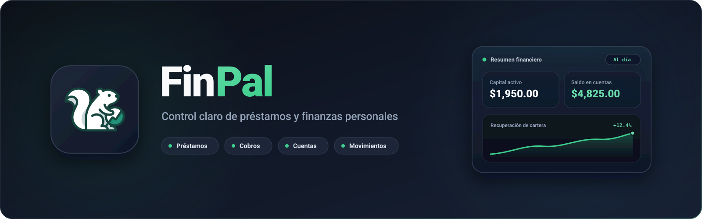

<p align="center">
  
</p>

<p align="center">
  Todo tu control financiero personal en un solo lugar.
</p>

<p align="center">
  <a href="https://www.npmjs.com/package/next"></a>
  <a href="https://www.npmjs.com/package/react"></a>
  <a href="https://www.npmjs.com/package/typescript"></a>
  <a href="https://www.npmjs.com/package/@supabase/supabase-js"></a>
  <a href="https://www.npmjs.com/package/tailwindcss"></a>
</p>

FinPal nació de un problema personal: mantener las cuentas y los registros repartidos entre distintas hojas de cálculo y notas para consultar reportes. Es una aplicación web en español que reúne cuentas de dinero, movimientos, cobros, contactos y préstamos en un solo lugar, accesible desde el celular o cualquier dispositivo con conexión a internet.

El proyecto no pretende reemplazar un sistema contable empresarial; está diseñado como una herramienta ágil, clara y privada para llevar el control real de préstamos personales, liquidez en cuentas y seguimiento de cobros sin perder el historial.

## Qué permite hacer

### Préstamos, simulador y cobros
- **Préstamos flexibles:** registra préstamos con frecuencia **mensual, quincenal o semanal**, interés por ciclo, fecha de desembolso, día esperado de cobro y duración opcional en cuotas.
- **Simulador de cuotas integrado:** calcula antes de prestar la proyección de pagos bajo modalidad de **abono fijo a capital** o **cuota fija (Sistema Francés)**, o aplica una cuota sugerida con un clic.
- **Cobros con trazabilidad real:** registra cobros completos, atrasados, parciales o **solo interés**, distinguiendo siempre el período devengado de la fecha en que se recibió el dinero.
- **Expediente / Kardex 360° del préstamo:** consulta en una sola vista la barra de amortización de capital recuperado, el historial cronológico de pagos y realiza **ampliaciones de capital (refinanciamiento)** con abono o descuento directo en cuenta.
- **Comprobantes digitales y reversiones:** genera recibos de cobro listos para copiar o imprimir en PDF y anula cobros registrados por error revirtiendo automáticamente los saldos e historiales.

### Deudores y directorio de contactos
- **Ficha 360° del contacto:** visualiza el capital activo en calle, interés acumulado, historial de préstamos y cobros, e indicador automático de **puntualidad de pago** (*Excelente*, *Regular* o *Riesgo alto*).
- **Gestión e importación ágil:** archiva o reactiva contactos sin perder su historial, personaliza el color de su avatar e importa carteras desde archivos **CSV o Excel (`.xlsx`)**.

### Cuentas, movimientos y espacios de trabajo
- **Cuentas de dinero y auditoría:** administra saldos de efectivo, bancos, billeteras digitales o ahorros con colores personalizados y consulta el **historial de auditoría de cambios** de cada cuenta.
- **Movimientos y transferencias en 1 paso:** registra ingresos, gastos, ajustes justificados y **transferencias directas entre cuentas** creando ambos movimientos vinculados de forma atómica.
- **Múltiples espacios financieros:** separa tus finanzas (por ejemplo, *Personal*, *Préstamos* o *Negocio*), cada uno con su propia **moneda** (`BOB`, `USD`, `EUR`, `ARS`, `PEN`, `CLP`, `MXN`, `COP`) y **zona horaria**.
- **Alertas y analítica (BI):** recibe avisos en la campana de vencimientos próximos o en mora, explora gráficos de flujo de caja y distribución de cartera, y exporta reportes en **CSV o PDF**.
- **Personalización visual:** alterna entre modo claro, oscuro o automático y elige el color de acento de toda la interfaz.

## Seguridad y privacidad

- **Cifrado en servidor (`AES-256-GCM`):** los datos personales sensibles de contactos (teléfonos, correos y notas) y observaciones se cifran en el servidor antes de guardarse en la base de datos.
- **Row Level Security (`RLS`):** todas las tablas en PostgreSQL cuentan con políticas de aislamiento por usuario (`auth.uid()`) y funciones transaccionales seguras.
- **Validación y cabeceras HTTP:** esquemas estrictos con **Zod** en cliente y servidor, protección contra duplicidad mediante llaves de idempotencia y cabeceras de seguridad (`CSP`, `HSTS`, `X-Frame-Options`).
- **Derecho al Olvido:** opción integrada en configuración para eliminar de forma definitiva e irreversible la cuenta del usuario y todos sus datos financieros.

## Estado

El producto cuenta con un flujo completo y funcional de punta a punta para espacios de trabajo, cuentas, transferencias, préstamos con simulador, cobros parciales con comprobante, expediente 360° de deudores, reportes analíticos y seguridad endurecida. Se siguen incorporando mejoras continuas de experiencia de usuario conforme evoluciona el proyecto.

## Tecnologías

- **Next.js 16** con App Router, React Server Components y Server Actions.
- **React 19** y **TypeScript 5**.
- **Supabase** para PostgreSQL, autenticación, funciones RPC transaccionales y Row Level Security (RLS).
- **Tailwind CSS 4**, **Lucide Icons** y **Motion** para la interfaz y micro-interacciones.
- **React Hook Form** y **Zod 4** para validación de formularios y esquemas.
- **Recharts** y **SheetJS (`xlsx`)** para visualización de datos e importación/exportación de reportes.
- **Vercel** para el despliegue continuo.

## Puesta en marcha local

1. Instala **Node.js 20** o una versión posterior compatible con Next.js 16.
2. Clona el repositorio e instala las dependencias:

   ```bash
   npm install
   ```

3. Copia `.env.example` a `.env.local` y configura las variables de entorno:

   ```env
   NEXT_PUBLIC_SUPABASE_URL=https://tu-proyecto.supabase.co
   NEXT_PUBLIC_SUPABASE_PUBLISHABLE_KEY=tu-clave-publica-anon
   NEXT_PUBLIC_SITE_URL=http://localhost:3000
   APP_ENCRYPTION_KEY=tu-llave-hexadecimal-de-64-caracteres
   ```

   > Puedes generar una llave segura para `APP_ENCRYPTION_KEY` ejecutando en tu terminal:
   > ```bash
   > node -e "console.log(require('crypto').randomBytes(32).toString('hex'))"
   > ```

4. En el **SQL Editor** de tu proyecto en Supabase, ejecuta los scripts de `supabase/setup` en este orden exacto:
   1. `1-creacion-tablas.sql` *(tablas base, tipos enumerados y vistas)*
   2. `2-funciones-y-triggers.sql` *(funciones transaccionales RPC y triggers automáticos)*
   3. `3-indices-y-seguridad.sql` *(índices de rendimiento y políticas RLS)*
   4. `4-endurecimiento-seguridad.sql` *(restricciones adicionales e idempotencia)*
   5. `5-auditoria-cambios.sql` *(registro automático de auditoría para cuentas)*
   6. `6-cuotas-y-derecho-olvido.sql` *(soporte de frecuencia de cobro, cuotas y eliminación total de cuenta)*

5. En **Supabase Auth**, habilita el proveedor **Email** y añade `http://localhost:3000/**` (y tu dominio de producción) en las URLs de redirección permitidas.
6. Inicia el servidor de desarrollo:

   ```bash
   npm run dev
   ```

   La aplicación estará disponible en `http://localhost:3000`.

Para validar el tipado y una compilación de producción antes de desplegar:

```bash
npm run build
npm start
```

## Configuración de despliegue

En **Vercel** (o tu proveedor de alojamiento), configura las siguientes variables de entorno:

```env
NEXT_PUBLIC_SUPABASE_URL=https://tu-proyecto.supabase.co
NEXT_PUBLIC_SUPABASE_PUBLISHABLE_KEY=tu-clave-publica-anon
NEXT_PUBLIC_SITE_URL=https://tu-proyecto.vercel.app
APP_ENCRYPTION_KEY=tu-llave-hexadecimal-de-64-caracteres
```

> **Importante:** conserva respaldada tu variable `APP_ENCRYPTION_KEY`. Si se reemplaza en producción sin migrar los datos, los campos sensibles cifrados previamente no podrán descifrarse.

La moneda predeterminada al crear el primer espacio es **BOB (Bs)** y la zona horaria inicial es `America/La_Paz`; ambas pueden personalizarse de forma independiente en cada espacio de trabajo desde el panel de **Espacios**.

## Principio de diseño

Los pagos, desembolsos, ampliaciones de capital y movimientos son **eventos históricos inmutables**. Los totales, saldos disponibles y estados de cada préstamo se calculan y actualizan de forma transaccional a partir de esos registros; ningún saldo o deuda se sobrescribe en silencio sin dejar un evento verificable en el historial.
